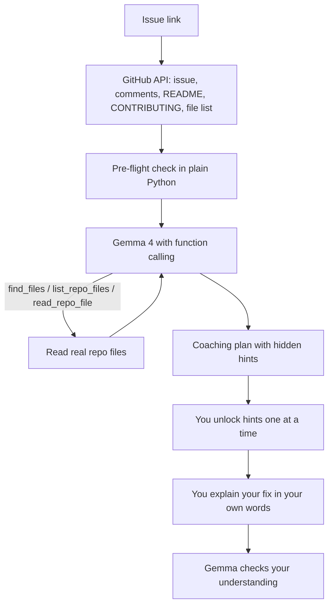

# FirstPR Coach

**A Gemma 4 mentor that coaches you through your first open-source pull request, instead of writing it for you.**

Paste a GitHub issue link. FirstPR Coach reads the issue, the README, the contribution rules and the code, checks whether the issue is actually safe to start, and walks you through it with a ladder of hints. Then it asks you to explain your fix in your own words before you open the pull request.

Built for **Hacktoberfest Hack Day Accra x Code & Cocktails** (MLH), for the **Best Use of Gemma 4** category. Open source under the MIT license.

<!-- TODO: add a screenshot or short GIF of a real run here, e.g. docs/demo.png -->

---

## The problem

First-time contributors get stuck in the gap between *finding* an issue and *finishing* it: which file matters, how to run the tests, whether someone else already claimed the issue, what the maintainers expect.

Meanwhile maintainers are dealing with a flood of low-effort pull requests. MLH and DEV changed Hacktoberfest in 2026 partly because [box-checking pull requests were burning maintainers out](https://blog.mlh.com/mlh/hacktoberfest-2026-ai-belongs-to-everyone-3jl8), and GitHub has publicly acknowledged that [low-quality, often AI-generated contributions are overwhelming open-source projects](https://www.opensourceforu.com/2026/02/github-weighs-pull-request-kill-switch-as-ai-slop-floods-open-source/).

Beginners need help. Maintainers need that help to make beginners *better*, not to automate the spam.

## What makes it different

The tools I found fall into two groups, and FirstPR Coach sits in the gap between them.

| | Issue finders<br>([Good First Issue](https://goodfirstissue.dev/), [Up For Grabs](https://up-for-grabs.net/), GitHub labels) | Coding agents that write the fix | **FirstPR Coach** |
|---|---|---|---|
| Helps you find an issue | Yes | No | Yes, ranked for *your* skills |
| Helps you understand the issue and repo | No | Not for you | **Yes** |
| Warns if the issue is claimed or stale | No | No | **Yes, checked by code** |
| Writes the pull request | No | Yes | **Never, by design** |
| Checks that you understood your own change | No | No | **Yes** |

1. **Coach, don't write the fix.** The system prompt forbids patches. You get a three-step hint ladder: a question to investigate, a narrowed-down location, then the shape of the fix in words only. Hints stay hidden until you press Enter.
2. **A pre-flight check before you spend hours.** Plain Python (not AI) checks whether the issue is closed, assigned, stale, or has comments where someone already claimed it or linked a pull request. Maintainers have asked contributors to [wait to be assigned before opening a pull request](https://dev.to/0xgosu/github-ai-slop-meets-the-author-loophole-g0n), and good project guides tell you to [comment on the issue first](https://arrow.apache.org/docs/developers/guide/step_by_step/finding_issues.html). The tool does the checking and drafts the comment for you.
3. **An understanding check.** Before you open the pull request, you explain your plan in your own words and Gemma tells you what is right, what is missing and whether you seem ready. Maintainers draw a line between [AI-assisted work (the human drives and understands the change) and AI-generated work (the human just submits)](https://ep2026.europython.eu/session/defending-open-source-from-ai-slop-a-maintainer-s-practical-guide/). This tool is built to keep you on the right side of that line.
4. **It reads the repo like a person would.** Gemma decides which files to open through function calling, so the advice is grounded in the real code instead of generic tips.
5. **It meets you where you are.** Tell it your skills and level, and get the explanation in your own language.

## How Gemma 4 is used

Everything goes through the Gemini API with a Google AI Studio key. All calls live in [`gemma_client.py`](gemma_client.py), and every run prints how many Gemma calls it made.

| Gemma 4 capability | What it does here | Where |
|---|---|---|
| System instructions | The "coach, never write the fix" rules | `prompts.py`, `gemma_client._config` |
| Function calling | Gemma chooses which repo files to search and read | `coach.TOOL_DECLARATIONS`, `gemma_client.run_with_tools` |
| Thinking mode | `high` for plans, `minimal` with `--fast` | `gemma_client._config` |
| Image understanding | `--image` reads a screenshot of an error, failing test or UI | `gemma_client.image_part` |
| Long context | README, CONTRIBUTING, issue thread, file list and code in one prompt | `coach.build_plan_prompt` |
| Multilingual output | `--lang "French"` (quality varies by language) | `prompts.language_line` |
| Two model sizes | 26B mixture-of-experts by default, 31B dense with `--model 31b` | `gemma_client.resolve_model` |

Audio input is a small-model feature and is not used here.

## How it works



A full plan uses at most 7 Gemma calls by default (up to 6 tool steps plus the final plan), and 1 more if you do the understanding check. `find` uses 1. That fits comfortably inside free-tier limits.

## Quick start

You need Python 3.10 or newer and a free API key from [Google AI Studio](https://aistudio.google.com/apikey).

```bash
git clone https://github.com/YOUR-USERNAME/firstpr-coach.git
cd firstpr-coach
pip install -r requirements.txt
```

### Where the API key goes

1. Copy `.env.example` to a new file named **`.env`** (Windows: `copy .env.example .env`, macOS/Linux: `cp .env.example .env`).
2. Open `.env` and replace `PASTE_YOUR_KEY_HERE` with your key.
3. Save. The `.env` file is listed in `.gitignore`, so it will not be committed. **Never paste your key into the code, an issue, or a screenshot.**

### Check that Gemma 4 answers

```bash
python main.py check
```

On Windows, use `py` instead of `python` if `python` is not recognised.

## Usage

**Find a beginner issue that fits you**

```bash
python main.py find OWNER/REPO --skills "python, html" --level beginner
```

**Get a coaching plan for one issue**

```bash
python main.py plan https://github.com/OWNER/REPO/issues/123
```

Useful options:

| Option | What it does |
|---|---|
| `--image error.png` | Gemma reads a screenshot of the error, failing test or UI |
| `--skills "python, html"` | Tailors the plan to what you already know |
| `--level beginner\|intermediate\|advanced` | Sets how much detail you get |
| `--lang "French"` | Explanations in another language |
| `--model 31b` | Stronger reasoning, slower (default is the faster 26B model) |
| `--fast` | Minimal thinking, saves time and quota |
| `--hints-all` | Show every hint at once |
| `--no-explain-back` | Skip the understanding check |
| `--save plan.md` | Save the full plan to a file |
| `--max-tool-steps 4` | Limit how many repo-reading steps Gemma may take |

Optional: add a free `GITHUB_TOKEN` to `.env` to raise GitHub's limit from 60 to 5,000 requests per hour.

## Project layout

```
firstpr-coach/
├── main.py            # command-line interface: check, find, plan
├── gemma_client.py    # every Gemma 4 call: key, model, retries, tool loop, images
├── coach.py           # pre-flight checks, repo tools for Gemma, plan/find/understanding flows
├── github_client.py   # GitHub REST helper (public data only)
├── prompts.py         # all prompts, including the coaching rules
├── tests/             # offline tests, no key or internet needed
├── .env.example       # copy to .env and add your key
├── requirements.txt
└── LICENSE
```

Run the tests with `python -m unittest discover -s tests -v`.

## Limitations

- **Free-tier limits.** Gemma 4 on the free Gemini API tier has low rate limits. The tool retries politely and tells you when to wait.
- **Hints are only as good as the model.** Gemma can be wrong. Check its advice against the code and the project's own docs, and ask the maintainers when unsure.
- **Claim detection is a heuristic.** It looks for phrases like "can I work on this" and links to pull requests. Always read the thread yourself.
- **Very large repos.** GitHub may truncate the file list, so Gemma relies more on keyword search there.
- **Public repos only.** Your prompts go to Google's API, so do not paste private or sensitive code, and check the data terms for your API tier.
- **Preview software.** Model names and API behaviour can change. The model IDs are set in one place (`gemma_client.py`).

## Roadmap

- A small web interface for people who prefer not to use a terminal
- An offline mode using a small local Gemma 4 model
- Per-project hint styles read from `CONTRIBUTING.md` or `AGENTS.md`
- Mentor mode for maintainers: turn an issue into a "good first issue" template

## Contributing

Issues and pull requests are welcome. Please open an issue first so we can agree on the change, run the tests, and be ready to explain every line you changed. That is the whole point of this project.

## License

MIT. See [LICENSE](LICENSE).

## Credits

Built with [Gemma 4](https://ai.google.dev/gemma/docs/core/gemma_on_gemini_api) from Google DeepMind through the Gemini API, for Hacktoberfest by MLH, DEV and DigitalOcean.
